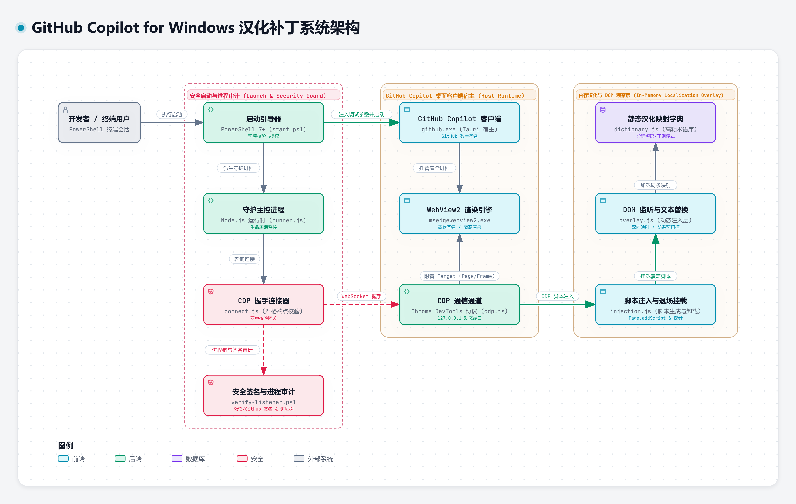

<div align="center">

# GitHub Copilot Desktop UI in Chinese
### GitHub Copilot Desktop 中文汉化层

*A non-invasive, in-memory Chinese localization overlay for GitHub Copilot Desktop powered by a strict structural allowlist and a hand-written dictionary*

[-0078D4?logo=windows)](https://learn.microsoft.com/microsoft-edge/webview2/)
[](https://github.com/features/copilot)
[](https://nodejs.org/)
[](https://github.com/PowerShell/PowerShell)
[](./README.en.md)

**[简体中文](./README.md) | English**

<p align="center">
  <a href="#-key-features">Key Features</a> •
  <a href="#-translation-scope--boundaries">Scope</a> •
  <a href="#-quick-start">Quick Start</a> •
  <a href="#-ask-an-ai-assistant-to-help-install">AI Install</a> •
  <a href="#-security-and-troubleshooting">Troubleshooting</a> •
  <a href="#-how-it-works--project-structure">How It Works</a> •
  <a href="#-performance-design--sample-metrics">Performance</a>
</p>

</div>

---

> [!IMPORTANT]
> **Source preview:** The overlay has been partially checked in a running application, but the normal launcher has not been tested end to end. Translation coverage is incomplete. The development target is **GitHub Copilot desktop 1.4.2** on Windows using WebView2 (this is not a claim of full version compatibility; the desktop app, WebView2 DOM, and debugging interface may change without notice, and other versions have not been tested).

This project translates selected fixed **Settings** text and verified static desktop UI controls in GitHub Copilot desktop using a strict DOM structural allowlist and a **hand-written Chinese dictionary**.

---

## ✨ Key Features

- **📖 Hand-Written Dictionary, Zero External Calls**: Does not use machine translation, download a model, or require an API key. Zero npm production dependencies at runtime.
- **🛡️ Non-Invasive In-Memory Overlay**: Never modifies the application executable (`github.exe`) or installation files. Press `Ctrl+C` or restart the app normally to restore everything cleanly.
- **🎯 Strict Translation Boundaries**: Translates fixed Settings text, static sidebar and Composer labels, and fixed copy in menus whose triggers and menu IDs are bidirectionally verified. Chat messages, tool output, Thinking/status labels, code, personal input/profile data, counts, and dynamic mode/model names stay unchanged.
- **🔐 Multi-Layer Security Verification**: Verifies Authenticode signatures for both `github.exe` (`GitHub, Inc.`) and `msedgewebview2.exe` (`Microsoft Corporation`), process ancestry, page origin (`http://tauri.localhost`), and `127.0.0.1` loopback binding before and after connecting.
- **⚡ Scoped Observation & Bounded Batching**: Observes narrow fixed-control roots, verified route-boundary direct children, and owned open menus; **it does not observe the conversation body subtree**. Batches stop at 150 nodes or a soft 4 ms budget checked between operations; an individual DOM operation can overrun that budget.

---

## 🎯 Translation Scope & Boundaries

### ✅ Translated (structural allowlist + exact dictionary match)

| UI Area | Details |
| :--- | :--- |
| **Settings Dialog** | Navigation items, section headers, option titles, descriptions, supported split paragraphs, and verified Settings listboxes/menus and action buttons. The observed Color filters subpage also translates the five fixed sample-status badges inside its titled same-origin preview iframe; example code and actual settings remain untouched. |
| **Repository Settings Page** | The server-ready-pattern heading/description, repository MCP empty-state labels and repository-removal deletion notice passed coordinated live checks. The removal summary's first mixed sentence still remains English in the observed application despite regression coverage; it is a known limitation, not complete coverage. The repository name, `serverReadyAction.pattern` code literal, regex input, and all repository/user values remain untouched. |
| **Session Activity Settings** | The `accessibility-announcements` heading, description, ten activity labels and On/Off labels are translated. The observed layout uses `li[data-subsetting-id]`, not `data-settings-row`: exact keys and the list's linked section heading establish ownership. Switch values are never changed. Corresponding real-time chat notifications remain English. |
| **Static Main-Window Controls** | Sidebar `New` / `Pull requests` / `Issues` / `Automations` / `Customize` navigation buttons (新建 / 拉取请求 / 议题 / 自动化 / 扩展中心) and Composer `Background` / `Artifacts` status labels. Sidebar labels require the verified navigation structure and matching `data-sidebar-nav-item` / `data-command` pairs; `New` additionally requires its `new` file-drop marker. Nested label spans, navigation mounting and replacement are supported without observing project/session lists. |
| **Bidirectionally Verified Menus** | Fixed copy in the Composer **mode menu**, **model/reasoning details**, **add-context menu**, sidebar **account menu** and **theme submenu**. Profile fixed labels translate without account identity text. The **tool-permissions submenu** now translates both titles (`始终询问` / `辅助模式` / `全部允许`) and the three fixed descriptions, superseding the earlier English-description exception; layout and selection remain unchanged. Model switch On/Off labels and the observed capable-model descriptions translate only in their verified switch/details owners; model/tier names do not. Accounts actions require an Accounts Settings trigger and valid popup ownership. |
| **Verified Page Controls** | PR/Issue page H1 titles and exact filter-label display mappings in the owned filter bar; Automations overview tabs/search/action and the verified setup composer title/description, Chat label and linked help description. The New automation dialog and Skills search/actions are not translated because their live ownership boundaries could not be verified; they are outside this release's allowlist. The Lexical composer's fixed `data-placeholder` and linked placeholder description can translate, but its input subtree is not walked or observed. Accessibility shortcut action paragraphs translate in the observed list/button layout. In the sampled desktop 1.4.2, opening Keyboard shortcuts displayed this same Settings Accessibility section, not a separate dialog. Keyboard bindings and live shortcut announcements remain unchanged. |
| **Image Annotation Toolbar** | Arrow / Rectangle / Pencil / Comment / Discard / Save translate only in the dedicated toolbar inside the verified fullscreen image-preview/editor chain. Radio values and selection remain unchanged. An annotation tooltip still needs a verified toolbar button's `aria-describedby` link and a portaled `role=tooltip` node; that standard-ARIA variant is fixture-tested, not yet live-hover verified. The editor, image, canvas, comments and preview filename are not read or translated. |
| **Verified Hover Tooltips** | The fixed `Share feedback` and `Settings` titles under the sidebar footer, plus `Mode` and `Model & reasoning` in the verified Composer footer, require their known active trigger with both `data-popup-open` and `:hover`, and the exact open top-aligned body portal/focusable shape. Only the title leaf is translated; keyboard-chord content is not read. A cached feedback dialog or another tooltip-like node is not an owner. |
| **Composer Usage Popover** | Requires the verified Composer `AI credits quota:` trigger, its `aria-controls` relation, and the exact dialog structure in a direct body portal. Translates Plan / Session / Tokens / Context labels, the two inert action labels, and the fixed `used`, `AI credits`, `cached`, and `reasoning` suffixes. Numeric and percentage prefixes, K/M counts, the Context button value, and the trigger's `aria-label` remain unchanged. This new implementation passes isolated fixtures but still needs live-app verification. |
| **Sidebar Section Labels** | Projects, its single-leaf No projects yet empty state, both observed Sessions headings and the fixed `sidebar-group-quick-chats` Chats label translate. Section/heading links and the dedicated two-span group structure are required: only its second, leaf span is the label. The first span's subtree is not read, translated or observed. Only fixed leaves and direct-child list-shell boundaries are observed, never project/session entry subtrees or user names. |
| **New Session Menu** | The dedicated `sidebar-new-session` trigger in the Sessions header and its bidirectional body-portal menu link own Chat, Start session in and the three Add actions. Action leaves require `chat.create` / `project.add-github` / `project.add-from-url` / `project.add-folder`. Only the exact direct decorative header may translate despite `aria-hidden`; other hidden labels remain unchanged. Observers cover fixed leaves and direct mount/known metadata boundaries, not the entire menu subtree or repository values. |
| **Voice Settings** | The observed `voice-mode-language` heading/description and microphone-permissions sentence translate. Auto maps only in that section's dedicated language-trigger label, not model names or generic dialogs. Other language labels and the saved language/permission values remain unchanged; language-popup options are not inferred from its trigger relation alone. |
| **Extensions Center Controls** | Dedicated Browse/Installed header tabs, Add trigger, search placeholder, All types, Editor’s picks title/description and the verified Add canvas card action only. Add menu items require the owned trigger/menu link and their observed item IDs (MCP Server, Plugin, Skill, Canvas from URL), with the fixed Manage marketplaces item; MCP/URL/Copilot remain unchanged. Skill submenus and the separate category-filter tablist are not inferred from these rules. |
| **Fixed Settings Choices** | System/Light/Dark controls in the observed Themes radiogroups with `data-value` and a linked section H2, including app and terminal groups without `data-settings-row`; the earlier row layout remains supported. Observed fixed `Last 3/7/14/30/90/180/360 days` choices translate only in the owned `sessions-cli-sessions` dropdown. Unlisted numeric options are not translated through a template. |

“Static” describes product copy, not when its DOM node is created: fixed menu/button labels may be mounted or updated dynamically and still translate. Arbitrary generated sentences, timestamps, percentages and actual values do not. This version removes the earlier variable discount/date, update-check timestamp and arbitrary Last N day(s) templates; only exact predefined choice labels remain.

### 🛡️ Untouched (explicitly excluded, never modified)

| UI Area | Details |
| :--- | :--- |
| **Conversations & Workspace** | Chat messages, `Thinking` / `Thought for N seconds` and other status labels, tool output, `Sent message …` lines, message-footer relative time and model information, and workspace files/paths. Footer ownership has not been verified, so these labels remain unchanged and are not scanned in this preview. |
| **Code & User Data** | Code blocks (`code`/`pre`), keyboard shortcuts (`kbd`), inputs and editable regions, user-provided names/paths/values, project/repository/profile data, and counts |
| **Proper Names & Unverified Tooltips** | Mode names (`Interactive` / `Plan` / `Autopilot`), model and tier names, other tooltips with unverified ownership, and unverified context popovers. Model/reasoning details are translated only while a verified model menu is open and the tooltip matches its dedicated details structure; no specific tier association is inferred. |
| **Native Voice Error Toast** | The fixed voice-busy error notification remains English: no positive native-toast owner was observed, and no recording was started to reproduce it. The implementation does not translate generic alerts or toasts. |
| **Work Filter Display Boundary** | In the verified PR/Issue filter bar, the exact labels Authored by me, Assigned to me, Involves me, Review requests, Done, Created by me and Mentioning me map to Chinese. An identically named custom filter receives the same reversible display mapping; its saved name, query and input values are not changed. Other custom names remain unchanged. A generic `role=tablist` alone does not qualify. `Nothing here` translates only with the observed complete direct-child empty shell and fixed `No items match ` message prefix. The dynamic message and filter name stay English. Only that empty message's leaf boundary is watched to revoke ownership; result-pane and transcript subtrees are not observed. |
| **External Marketplace & Automation Data** | Third-party card names/descriptions, installed resources, counts, automation names/runs and editable drafts remain unchanged. Only the specifically identified product controls translate; entire cards, catalog sections and results are not scanned. |
| **Profile Credit Usage** | The `AI credits used: N%` row remains English, including changing percentages. Other credit-related Settings copy is not globally excluded. |
| **Dynamic Values & Unverified Controls** | Discount percentages/dates, update-check timestamps and variable-value messages remain unchanged. Other segmented On/Off labels are not translated without a verified owner; verified controls retain their selected state. The ordinary nested Effort menu's Low/Medium/High/Extra High/Max labels translate only with the observed label/value leaves, nested popup and shared root-owner relation. Model/Effort/Context window (also Content window) headers require the fixed label slot or a noninteractive header in the verified model menu; model-name/value slots and 200K remain unchanged. Copilot Fusion `data-auto-tier-id` names stay English. No generic toolbar or global short-word matching is used. |

All detailed chat activity notifications remain English: thinking (`Thinking`, `Thinking…`, `Thinking...`, `Thought for N seconds`), `Sent message …`, tool/search/file actions, CLI status, model-agent changes and compaction. Shared labels are translated in their Settings section, not in the transcript; chat bodies are never translated or observed. Nested DIV menu triggers have separate title/value leaves: ownership uses the title, not their concatenated text. An inert or aria-hidden parent presentation remains a valid owner when a child menu opens; hidden mirrors inside the item and `kbd` shortcuts are ignored. Visible strings are never deduplicated.

Coordinated live checks on desktop 1.4.2 confirmed the four sidebar labels (including both Sessions headings), five PR/four Issue filter labels and both Nothing here captions, both Theme radiogroups, 62 Accessibility shortcut rows and ten announcement rows, dictation title/description and microphone guidance, and six permission-menu labels/descriptions with the inert-parent relation. The six annotation buttons translated when their toolbar was already mounted. After the lifecycle fix, the user visually confirmed Chinese on normal reopening without reinjection; the subsequent DOM probe found the toolbar unmounted, so this was not a second six-button DOM measurement. Delayed preview/editor/toolbar mounting is regression-tested using only the verified direct-child mount boundaries, without adding an editor subtree observer. The current model was Auto/Fusion: ordinary non-Fusion Effort, detailed Model/Context variants and unobserved Fusion detail variants do not have complete live acceptance in this batch; supported rules have observed structure and fixtures, and no model was changed for testing. Arrow hover did not expose `aria-describedby`, so the tooltip variant remains fixture-only. Dictation Auto was not selected for live testing.

The four New Session command labels and decorative header passed live checks. Closing and reopening with the native plus button, without reinjection, passed all five labels again. No menu action was selected and no session or repository was created.

A separate translation tool and its background companion can conflict with this overlay: stopping only its page instance may allow that companion to reinject it. Before a coordinated hot replacement, stop any other tool's companion through its standard stop mechanism, restore its page changes, then stop this project's previous instance and install the new version. This version does not guess English from existing Chinese text or rewrite the transcript; evaluating its injection while its existing instance is active does not replace that instance.

Page discovery follows the observed connected ancestor chain of verified controls, retaining only its main-container route prefix with direct-child observers. The sampled route replaced children at the third DIV while retaining the first three ancestor objects; this is not a blanket subscription to every third-level DIV or a universal layout claim. Page text observers attach to individual fixed controls; the editable Lexical control is attribute-only. Removed controls, invalid owner markers and lost popup ownership disconnect their observers and restore only unchanged project-written translations. Live coverage and remaining variants are listed above; this is not full-page acceptance.

---

The permissions-menu repair accepts the positively observed localized Mode accessibility label under the existing composer-footer and tooltip-trigger guards, without changing displayed professional mode names or the accessibility label. It also observes only direct children of an already-owned menu portal to discover a later nested portal, then observes the verified submenu itself for fixed-label rerenders. It does not observe the chat tree. The user accepted the repaired live menu for release v0.1.1; this does not remove the separate launcher and repository-removal limitations.

## 🚀 Quick Start

### 1. Requirements

| Component | Requirement |
| :--- | :--- |
| **OS & Application** | Windows, and **GitHub Copilot desktop** with WebView2 (target version `1.4.2`) |
| **PowerShell** | PowerShell 7 or newer (`pwsh`) |
| **Node.js** | Node.js 22 or newer (zero npm production dependencies at runtime) |
| **Git** | Standard Git installation to clone the repository |

### 2. Clone and Launch

Release **v0.1.1** includes `github-copilot-zh-0.1.1-source.zip`. Download it from this repository's [Releases](https://github.com/YOIMIYA66/github-copilot-zh/releases), extract it, review the source and license, and run `start.cmd` from the extracted folder. No npm installation is required to run the overlay. See [CHANGELOG.md](CHANGELOG.md) for release notes and known limitations.

> [!NOTE]
> These steps use the source preview. The normal launcher has not yet been validated end to end with a newly started application. During the startup wait, pressing `Ctrl+C` may still exit with a non-zero code. **Save your work and exit Copilot normally before running it.** Do not terminate Copilot forcibly or disable operating-system security.

```powershell
git clone https://github.com/YOIMIYA66/github-copilot-zh.git
Set-Location .\github-copilot-zh
# Review the downloaded source and license before executing the launcher.
.\start.cmd
```

- **Double-click**: You can also double-click `start.cmd` in the repository folder. On failure, its window stays open so you can read the error; press any key to close it.
- **Run the script directly**: When `.\start.ps1` is run from an interactive PowerShell, failures are shown and wait for Enter. `start.cmd` handles the pause itself to avoid prompting twice.
- **Administrator access**: The launcher does not request UAC elevation. Elevation does not resolve an already-running Copilot process; save your work and exit Copilot normally first.
- **Custom Installation Path**: The default executable is under `%LOCALAPPDATA%\Programs\GitHub Copilot\github.exe`. For another installation location, pass the actual executable path with `-AppPath`:
  ```powershell
  pwsh -NoProfile -File .\start.ps1 -AppPath "D:\CustomPath\GitHub Copilot\github.exe"
  ```
- **Runtime Behavior**: **Keep the terminal open** while using Copilot. The launcher starts a new signed application process and refuses to attach to an already-running instance.

### 3. Stop and Restore

- **Live Restore**: Press **`Ctrl+C`** in the terminal to unload the overlay and restore translated text back to English.
- **Remove Debug Port**: Exit Copilot normally and start it from its usual shortcut.
- **Unexpected Exit Recovery**: If the launcher or connection exits unexpectedly, normal app exit and restart clears the in-memory overlay. No persistent settings values are changed.

---

## 🤖 Ask an AI Assistant to Help Install

Copy this prompt to an AI assistant with access to your computer:

```text
Help me install the GitHub Copilot desktop UI translation from
https://github.com/YOIMIYA66/github-copilot-zh.
First check Windows, my GitHub Copilot desktop version, WebView2, PowerShell,
and Node.js. Read that repository's README, review its source and license, and
confirm the installation instructions and project URL before executing
anything. Treat an unverified or pre-release version as such and tell me if
the app version has not been validated. Save my work, and do not force-close
Copilot, disable security, expose credentials, or execute an unreviewed remote
script. Follow the repository's documented installation entry point only if I
approve the security risks. Verify that Settings and supported static UI labels/descriptions (including an
account action menu only when its ownership conditions are met) are translated;
chat messages, tool output, Thinking/status labels, and mode/model names remain
unchanged. Keep Thinking / Thought for N seconds and Sent message lines in
English. The supported Composer usage popover may translate its fixed labels and
suffixes only; preserve all numeric/percentage prefixes, K/M counts, Context values,
and its accessibility label. Keep other dynamic values, the Profile credit-usage row,
external marketplace content, custom filter names outside the exact whitelist and
unrelated empty states unchanged. Whitelisted same-name custom filters may change
display only, never their saved name or query. Validate new
page controls only within the README's verified scopes. Translate the supported Artifacts status chip, but do not translate
Artifacts text appearing in message bodies. Message-footer relative time and
model labels are not supported in this preview because their DOM ownership has
not been verified; leave them unchanged and do not scan the transcript to find
them. Do not claim controls without live verification are fully covered. Report any failure or
uncertainty and explain how to stop and restore the app.
```

---

## 🔒 Security and Troubleshooting

> [!WARNING]
> **Local Debugging Port Notice:** The debugging port is unauthenticated—other processes running as your user may be able to inspect or modify the application while debugging is enabled. Use it only on a trusted machine and close the app normally when finished. CDP and the WebView2 debug arguments are not stable Copilot APIs.

| Issue / Symptom | Cause & Resolution |
| :--- | :--- |
| **Existing `github.exe` process reported** | The launcher never terminates or attaches to existing processes. Save your work, exit Copilot normally, and retry. |
| **Verification or connection check fails** | If signature, listener, page identity, or connection checks fail, the launcher stops immediately without connecting to an unrecognized target or terminating the app. |
| **Labels remain English or controls behave unexpectedly** | The target version or DOM markup may have changed. Press `Ctrl+C` to stop the overlay and restart the app normally. |

---

## 🔍 How It Works & Project Structure

### System Architecture & Lifecycle

<p align="center">
  <picture>
    <source media="(prefers-color-scheme: dark)" srcset="docs/images/architecture-dark.png">
    <source media="(prefers-color-scheme: light)" srcset="docs/images/architecture-light.png">
    
  </picture>
</p>

<p align="center">
  <sub>💡 Tip: Open <a href="docs/architecture.html"><b>docs/architecture.html</b></a> directly in your browser for the full interactive diagram (viewport zoom, theme toggle, trace animations, and exact source code references).</sub>
</p>

The illustration summarizes the original launcher/overlay flow; the scope table above documents the additional page-control boundaries in this revision.

1. **Pre-flight & Signature Check (`start.ps1`)**: Verifies PowerShell 7+ and Node.js 22+, checks the `GitHub, Inc.` Authenticode signature on `github.exe`, and ensures no `github.exe` instance is already running.
2. **Loopback Debug Launch (`start.ps1`)**: Allocates an ephemeral loopback port and launches `github.exe` with `WEBVIEW2_ADDITIONAL_BROWSER_ARGUMENTS` bound strictly to `127.0.0.1`.
3. **Dual Process & Target Verification (`connect.js` / `verify-listener.ps1` / `cdp.js`)**: Before fetching `/json/list` and again after WebSocket open, verifies that the port is exclusively bound to `127.0.0.1` by a `Microsoft Corporation`-signed `msedgewebview2.exe` descending from the launched `github.exe` PID, and validates the `http://tauri.localhost` page target.
4. **Scoped Injection & Clean Restoration (`runner.js` / `injection.js` / `overlay.js`)**: Injects the scoped `MutationObserver` and dictionary; on `Ctrl+C`, deregisters the script and restores all tracked text nodes and attributes to their original values.

### Directory Layout

```text
github-copilot-zh/
├── start.cmd                # Double-click entry point (keeps error messages visible)
├── start.ps1                # PowerShell launcher (checks prerequisites, verifies signature, starts app)
├── docs/                    # Project documentation & architecture exports (interactive HTML & HiDPI diagrams)
├── src/
│   ├── runner.js            # Main runner (manages CDP lifecycle, script registration, and Ctrl+C cleanup)
│   ├── connect.js           # Verified connector (runs verify-listener.ps1 before and after WebSocket open)
│   ├── verify-listener.ps1  # Verifies loopback binding, WebView2 signature, and process tree ancestry
│   ├── cdp.js               # Zero-dependency minimal CDP client and page target selector (selectTarget)
│   ├── injection.js         # Page injection payload generator, removal logic, and diagnostic actions
│   ├── overlay.js           # Core DOM overlay (structural allowlists, MutationObserver, bounded batching)
│   ├── dictionary.js        # Hand-written English-to-Chinese fixed UI dictionary
│   └── diagnose.js          # Developer diagnostic CLI (install / status / stop)
└── test/
    ├── benchmark.js         # Synthetic JSDOM benchmark script
    ├── cdp.test.js          # Unit tests for CDP client and target selection
    ├── chrome.test.js       # Unit tests for static main-window UI and verified menus
    ├── injection.test.js    # Unit tests for script injection, origin checks, and diagnostics
    ├── launcher.test.js     # Tests for the Windows double-click entry point and failures
    ├── overlay.test.js      # Unit tests for Settings translation, dynamic mutations, and restoration
    ├── usage-popup.test.js  # Tests for fixed usage copy and dynamic-value isolation
    └── settings-pages.test.js # Unit tests for Settings page structural coverage
```

---

## ⚡ Performance Design & Sample Metrics

This design aims to keep overhead low and avoid observing streaming chat, **but does not guarantee zero overhead or smooth rendering on every device**. Below are single-run real-app and synthetic JSDOM samples for reference (timings vary by hardware and workload and are not a general performance guarantee).

### 1. WebView2 Diagnostic-Attachment Sample (GitHub Copilot desktop 1.4.2, single run)

The diagnostic overlay was installed in the running app, stopped/restored, and replaced with the normal `measure: false` overlay without restarting the app or changing any input or menu selection:

| Sample Window | `settingsScans` | `portalScans` | `chromeScans` | `callbacks` | Overlay Timing Summary |
| :--- | :---: | :---: | :---: | :---: | :--- |
| **~8 s before menu interactions (closed)** | `+0` | `+0` | `+0` | `+0` | No scans or callbacks triggered |
| **Open & close each of 4 menus once** | `+0` | `+12` | `+20` | `+23` | **5 batches**: p95 / max `1.40 ms` (`3.60 ms` total)<br>**26 callbacks**: p95 `0.30 ms` / max `0.40 ms` (`2.50 ms` total) |
| **~8 s after menu interactions (closed)** | `+0` | `+0` | `+0` | `+0` | No scans or callbacks triggered |
| **Final Cumulative Counts** *(incl. 4 root scans)* | `0` | `12` | `24` | `26` | — |

> **Sample Limitations**: These are internal overlay timings, not whole-app CPU, memory, or FPS measurements. This run exercised native-input menu open/close interactions only, without synthetic chat load or a sentence-by-sentence translation coverage audit. Account action menus and PR/Issue tabs were not individually rechecked in the live app.

### 2. Synthetic JSDOM Benchmark (`npm run benchmark`, single run)

`npm run benchmark` checks whether synthetic chat-body updates trigger Settings or fixed-UI scans and reports processing counts and timings on a synthetic JSDOM tree (**not a WebView2 measurement, CPU benchmark, or real-world rendering latency claim**). Only observed fixed time-window choices are translated in the owned `sessions-cli-sessions` dropdown. Accounts-page actions are matched only when their trigger belongs to the Accounts Settings page and popup ownership is valid; that menu structure has not been rechecked in the live app.

| Synthetic Benchmark Scenario | Metric | Observed Value |
| :--- | :--- | :--- |
| **5,000 synthetic chat nodes, 1,000 chat updates (Settings closed/open)** | Settings / portal / fixed-UI scans; callbacks; elapsed | `0` / `0` / `0`; `0`; `250.70/234.68 ms` |
| **1,000 updates each to project/session text and the Chats count (3,000 total)** | Scans / callbacks | All `0` |
| **1,201 synthetic Settings elements (300 rows), initial translation through last item** | From dialog insertion to last heading and description | `312.02 ms` |
| **1,201 synthetic Settings elements, 1,000 fixed-label updates** | Settings scans; batch count / p95/max; observer callback count / p95/max; elapsed | `1,000`; `50` / `2.25/2.52 ms`; `150` / `0.20/0.29 ms`; `821.67 ms` |
| **Unverified PR/Issue / Automations / removed work page, same chat load** | Scans / callbacks; elapsed by scenario | All `0`; `232.97/199.96/234.56 ms` |
| **Verified PR filters present, same chat load** | Scans / callbacks; elapsed | All `0`; `237.24 ms` |
| **1,000 result-text updates inside the verified PR pane** | Settings / portal / fixed-UI scans; callbacks | `0` / `0` / `0`; `0` |
| **Verified Automations header present / removed, same chat load** | Scans / callbacks; elapsed by scenario | All `0`; `235.64/249.48 ms` |
| **3 verified page controls, 300 label updates** | Fixed-UI scans; batch count / p95/max; callback count / p95/max; elapsed | `300`; `50` / `1.41/1.58 ms`; `150` / `0.71/1.02 ms`; `465.55 ms` |
| **1,000 external-card description updates** | Scans / callbacks; elapsed | All `0`; `31.58 ms` |
| **5 fixed sidebar controls, 500 label updates** | Fixed-UI scans; batch count / p95/max; observer callback count / p95/max; elapsed | `500`; `50` / `1.21/1.43 ms`; `139` / `0.78/0.97 ms`; `252.41 ms` |
| **New Session menu present, same chat load** | Scans / callbacks; elapsed | All `0`; `202.79 ms` |
| **1,000 repository-text updates in that menu** | Scans / callbacks; elapsed | All `0`; `14.88 ms` |

The benchmark includes verified sidebar and page controls and their direct-child boundaries. It measures selected scenarios, not full-page coverage. Setup translation and route bookkeeping settle before chat measurement; any chat-triggered scan or callback fails the benchmark. Update samples exclude initialization. The 4 ms drain budget is soft, not a hard deadline; this run's largest measured batch was 2.52 ms, but an individual DOM operation can overrun the target on another run. **57 tests** pass, including Settings, color-filter previews, verified sidebar/composer tooltips, real Accessibility/Theme layouts, inert-parent nested menus and selected-value protection, complete empty-shell matching and revocation, delayed image-toolbar mounting/restoration/reacquisition and unread preview filenames, sidebar group/count privacy, command-owned session-menu labels/decorative header and repository-value isolation, usage-popover fixed suffixes without reading/observing value nodes, dictation Auto isolation, and unchanged chat/input/result content. Annotation input changes cause no scans in the fixture, but the existing portal observer can still receive callbacks; zero annotation-input overhead is not claimed. These tests and samples are not a live UI census. Live acceptance limitations are listed above. The earlier WebView2 sample above does not measure these newly added surfaces.

---

## 🛠️ Development

### Tests and Benchmark

`npm install` installs the development-only `jsdom` dependency and its transitive dependencies, whose license information is recorded in `package-lock.json`:

```powershell
npm install
npm test           # Run isolated unit tests
npm run benchmark  # Run synthetic DOM benchmark
```

### Diagnostic Attachment

Only with the user's explicit consent, and with no other translation overlay active, a developer can attach to an existing **already-debuggable** Copilot process without restarting or refreshing it (this does not test the normal launcher). Supply the actual debug port and signed Copilot process ID:

```powershell
$port = 12345 # Replace with the verified loopback debug port.
$appPid = 1234 # Replace with the verified GitHub Copilot process ID.
$app = Get-CimInstance Win32_Process -Filter "ProcessId=$appPid"
node .\src\diagnose.js install $port $appPid $app.ExecutablePath
node .\src\diagnose.js status $port $appPid $app.ExecutablePath
node .\src\diagnose.js stop $port $appPid $app.ExecutablePath
```

- **Verification**: Each command verifies the loopback listener, its WebView2 signature and ancestry, the signed app process, and the page target before attaching. Installation affects only the current page; it does not register a script for future navigations. `stop` restores the diagnostic overlay's changes without closing the app and does not stop unrelated overlays.
- **Privacy-Preserving Metrics**: `status` returns only `settingsScans`, `portalScans`, `chromeScans`, `callbacks`, a cumulative count of distinct eligible fixed text nodes without a matching translation, and up to the latest 512 `batchMs` and `callbackMs` duration samples. **It does not return page text, account details, paths, or input values.** The unmatched count covers only the supported structural allowlist, can include fragments, and is **not** a count of all untranslated UI; zero does not mean complete coverage.

---

## 📄 License

This project is licensed under the [MIT License](./LICENSE).
