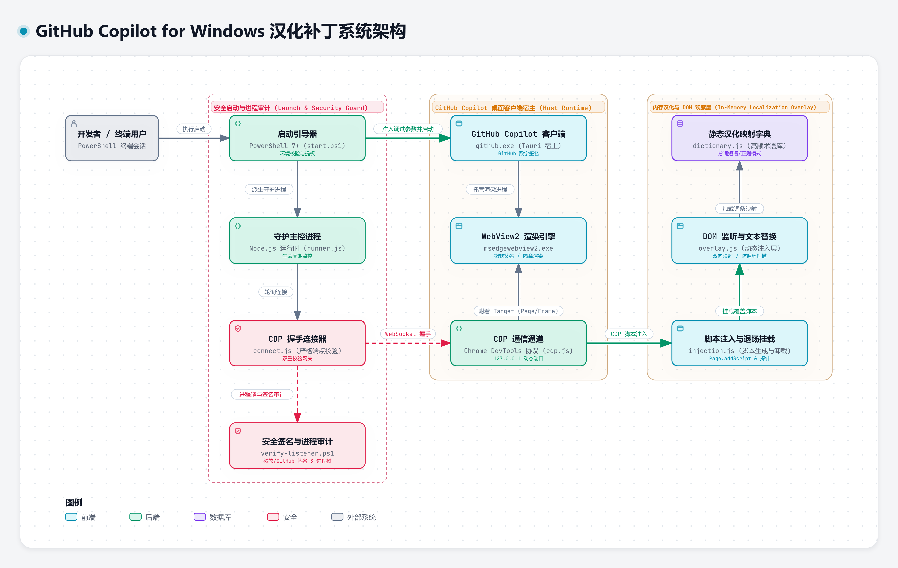

<div align="center">

# GitHub Copilot Desktop 中文汉化层
### GitHub Copilot Desktop UI in Chinese

*基于结构白名单与纯人工词典的 GitHub Copilot 桌面端非侵入式内存汉化工具*

[-0078D4?logo=windows)](https://learn.microsoft.com/microsoft-edge/webview2/)
[](https://github.com/features/copilot)
[](https://nodejs.org/)
[](https://github.com/PowerShell/PowerShell)
[](./README.md)

**简体中文 | [English](./README.en.md)**

<p align="center">
  <a href="#-核心特性">核心特性</a> •
  <a href="#-翻译范围与边界">翻译范围</a> •
  <a href="#-快速开始">快速开始</a> •
  <a href="#-让-ai-助手协助安装">AI 安装</a> •
  <a href="#-安全说明与故障排除">安全排错</a> •
  <a href="#-工作原理与项目结构">工作原理</a> •
  <a href="#-性能设计与采样数据">性能数据</a>
</p>

</div>

---

> [!IMPORTANT]
> **源码预览版（Source Preview）：** 汉化层已在运行中的应用上进行部分验证，但普通启动器的完整启动流程尚未端到端测试，翻译覆盖也尚不完整。开发目标为 Windows 上使用 WebView2 的 **GitHub Copilot desktop 1.4.2**（这不代表该版本完全兼容；桌面应用、WebView2 DOM 和调试接口均可能随时变化，其他版本尚未测试）。

本项目通过精细的 DOM 结构白名单与**纯手工编写的中文词典**，为 GitHub Copilot 桌面端提供非侵入式的**设置（Settings）与固定界面控件**内存汉化层。

---

## ✨ 核心特性

- **📖 纯人工词典，零外部服务**：不使用机器翻译、不下载模型、不需要 API 密钥，运行时**零 npm 生产依赖**。
- **🛡️ 非侵入式内存覆盖**：绝不修改应用程序可执行文件（`github.exe`）或安装目录文件；按 `Ctrl+C` 或正常重启应用即可完全还原。
- **🎯 严格的翻译边界**：仅翻译已确认归属的设置文案、静态导航与 Composer 标签，以及通过触发器和菜单 ID 双向关联确认的固定菜单项与说明。聊天正文、工具输出、思考状态、代码、个人输入/资料、计数和动态模式/模型名称保持原文。
- **🔐 多重安全校验**：启动与连接前后双重验证 `github.exe`（`GitHub, Inc.`）与 `msedgewebview2.exe`（`Microsoft Corporation`）的 Authenticode 数字签名、进程树归属、页面 Origin（`http://tauri.localhost`）及 `127.0.0.1` 回环绑定。
- **⚡ 按需监听与分批处理**：仅观察窄范围固定控件根、主容器的直接子节点以及已验证关联的打开菜单，**不观察对话正文子树**。设置和菜单变化按有限批次（每批最多 150 节点 / 4 毫秒时间片）处理。

---

## 🎯 翻译范围与边界

### ✅ 会翻译（结构白名单 + 词典精确匹配）

| 适用区域 | 具体内容 |
| :--- | :--- |
| **设置对话框** | 设置导航栏、分类标题、选项标签、说明文本、受支持的跨节点拆分段落，以及归属已验证的设置下拉框与操作按钮 |
| **会话活动设置** | 翻译 `accessibility-announcements` 标题、说明、推理 / 工具调用 / 代码搜索 / 读取、创建和编辑文件 / CLI 运行与完成 / 模型与代理切换 / 上下文压缩标签及 On/Off 标签，绝不改变开关值。对应的聊天实时活动通知仍保持英文。 |
| **主界面静态控件** | 侧边栏 `New` / `Pull requests` / `Issues` / `Automations` / `Customize` 导航按钮（新建 / 拉取请求 / 议题 / 自动化 / 扩展中心）及 Composer 顶部 `Background` / `Artifacts` 状态标签。侧栏要求经验证的导航结构及成对匹配的 `data-sidebar-nav-item` / `data-command`；`New` 还需 `new` 文件拖放标记。支持深层标签 span、导航挂载和替换，不观察项目/会话列表。 |
| **双向关联弹出菜单** | 经触发器与菜单 ID 双向验证的 Composer **模式菜单**、**模型与推理说明**、**添加上下文菜单**、侧边栏**账户菜单**（含 `Switch account`、`Theme`、`Keyboard shortcuts`、`Sign out`）及其**主题子菜单**固定文案。Profile 支持深层 span、直接 span 和菜单按钮文字位置，不翻译账号身份内容。**工具权限子菜单**保留原生两行布局：上方标题为“始终询问 / 辅助模式 / 全部允许”，下方说明保持原生英文，不改变选中状态。仅当设置 **Accounts** 页内的菜单触发器与弹层关联有效时，才匹配 `Update authorization` / `Manage plan` / `Remove account` / `Set as default` |
| **设置内固定选择器** | Themes 的已知设置 section 中 `data-settings-row` 内 System / Light / Dark 控件；会话时间范围下拉框中仅限已归属 `sessions-cli-sessions` 且已观测的固定 `Last 3/7/14/30/90/180/360 days` 选项。未列出的数值选项不会通过模板翻译。 |

“静态”指产品固定文案，不是 DOM 创建时间：菜单或按钮即使动态挂载/更新，固定标签仍可翻译；任意生成句子、时间戳、百分比及实际值不翻。本版移除此前的可变优惠/日期、更新检查时间和任意 Last N day(s) 模板，仅保留精确匹配的预定义选项。

### 🛡️ 保留原文（显式排除，绝不修改）

| 适用区域 | 具体内容 |
| :--- | :--- |
| **对话与工作区** | 聊天正文、`Thinking` / `Thought for N seconds` 和其他状态标签、工具输出、`Sent message …` 行、消息页脚中的相对时间与模型信息、工作区文件与路径。页脚尚无经验证的归属结构，因此当前版本保持原文，不进行扫描或翻译。 |
| **代码与用户输入** | 代码块（`code`/`pre`）、键盘按键（`kbd`）、输入框与可编辑区域、用户自定义名称/路径/数值、项目/仓库/个人资料及各类计数 |
| **专有名称与未知提示** | `Interactive` / `Plan` / `Autopilot` 模式名、模型与级别名称，以及归属无法确认的其他工具提示。模型推理详情仅在经验证的模型菜单同时打开且提示符合专用详情结构时翻译；不推断其对应的具体级别。 |
| **工作页面子导航与空状态——暂未支持** | PR、Issue、Automations 子页面页签及 `Nothing here` 保留英文。实机已确认 PR/Issue 的深层 `my-work-inbox-view` / `my-work-filter-bar` 容器和页签语义，但尚未确认如何区分内置页签与用户自定义筛选，以及空状态与列表内容；Automations 页头/页签结构也仅部分确认。已移除先前通用的 `role=tablist` 匹配：仅凭这些角色与相同文字不能安全判定归属。未新增工作页面或聊天正文观察器。 |
| **Profile 点数用量** | `AI credits used: N%` 整行保持英文，包含变化的百分比；不会全局排除其他与点数相关的设置文案。 |
| **动态值与未验证控件** | 优惠百分比/日期、更新检查时间及可变数值消息保持原文。图片标注工具栏归属和强度组选项（`Standard` / `High` / `Max`，需与同名模型/级别专有名称区分）尚未确认；不使用普通 toolbar 或全局短词匹配。 |

聊天中所有具体活动通知保持英文，包括思考（`Thinking`、`Thinking…`、`Thinking...`、`Thought for N seconds`）、`Sent message …`、工具/搜索/文件操作、CLI 状态、模型/代理切换及压缩；共享标签只在对应设置分区翻译，不翻译或观察聊天正文。子菜单归属读取忽略明确标记为 `aria-hidden` / `hidden` 的镜像和 `kbd` 快捷键，绝不对任意可见字符串去重；镜像处理已通过回归测试，并非每个实机菜单都已单独验证。

其他汉化工具及其后台伴随进程可能与本项目冲突：只停用页面实例，后台进程仍可能重新注入。协调热替换前，应先使用其他工具的标准停用入口关闭其伴随进程、恢复其页面改动，再停用本项目旧实例并安装新版。新版本不会根据已有中文猜测英文或反向改写正文；本项目已有实例运行时，重复执行注入不会替换该实例。

---

## 🚀 快速开始

### 1. 环境要求

| 组件 | 要求说明 |
| :--- | :--- |
| **操作系统与应用** | Windows，以及使用 WebView2 的 **GitHub Copilot desktop**（开发目标版本 `1.4.2`） |
| **PowerShell** | PowerShell 7 或更高版本（`pwsh`） |
| **Node.js** | Node.js 22 或更高版本（运行时无任何 npm 生产依赖） |
| **Git** | 用于克隆本项目仓库 |

### 2. 克隆并启动

> [!NOTE]
> 以下步骤使用源码预览版。正常启动器通过新启动应用完成整个流程尚未端到端验证；启动等待阶段按 `Ctrl+C` 目前仍可能以非零退出码结束。**运行前请先保存工作并正常退出 Copilot**；不要强制结束 Copilot，也不要关闭操作系统安全防护。

```powershell
git clone https://github.com/YOIMIYA66/github-copilot-zh.git
Set-Location .\github-copilot-zh
# 执行启动器前请先审阅下载的源代码与许可证 (LICENSE)
.\start.cmd
```

- **双击启动**：也可以在资源管理器中双击仓库目录的 `start.cmd`。如启动失败，窗口会保留错误提示；阅读提示后按任意键关闭。
- **直接运行脚本**：如果从交互式 PowerShell 直接运行 `.\start.ps1`，启动失败时会显示错误并等待按 Enter；`start.cmd` 会自行保留错误窗口，避免重复暂停。
- **管理员权限**：启动器不会主动请求 UAC 提权。已有 Copilot 正在运行时，提权也不能解决问题；请先保存工作并正常退出 Copilot。
- **自定义安装路径**：默认可执行文件路径为 `%LOCALAPPDATA%\Programs\GitHub Copilot\github.exe`。若安装在其他位置，请通过 `-AppPath` 传入实际路径：
  ```powershell
  pwsh -NoProfile -File .\start.ps1 -AppPath "D:\CustomPath\GitHub Copilot\github.exe"
  ```
- **运行要求**：使用 Copilot 期间请**保持终端窗口打开**。启动器仅启动新的已签名应用进程，拒绝附加到已运行的应用。

### 3. 停止与还原

- **在线还原**：在终端按 **`Ctrl+C`** 即可卸载内存汉化层，并将页面上已翻译的文本恢复为英文原样。
- **彻底关闭调试端口**：正常退出 Copilot，之后从桌面或开始菜单的常规快捷方式重新启动即可。
- **异常退出恢复**：如果启动器或调试连接意外中断，只需正常退出并重启 Copilot 应用即可清除内存中的汉化层。本工具不会修改任何持久化的应用设置值。

---

## 🤖 让 AI 助手协助安装

你可以将以下提示词直接复制给能够访问你电脑的本地 AI 助手（如 Claude Code、Copilot CLI、Cursor 等）：

```text
请帮我从以下仓库安装 GitHub Copilot 桌面端界面汉化：
https://github.com/YOIMIYA66/github-copilot-zh。
首先检查 Windows、GitHub Copilot desktop 版本、WebView2、PowerShell 和 Node.js。
阅读该仓库的 README，检查源代码和许可证，并在执行任何操作前确认安装说明和项目 URL。
如实说明未验证或预览版的状态，并告知我应用版本是否尚未验证。请保存我的工作，
不要强制关闭 Copilot、关闭安全防护、泄露凭据或执行未经检查的远程脚本。
只有在我同意安全风险后，才使用仓库中记录的安装入口。
验证设置和已支持的静态界面标签/说明（包括符合所属条件的账户操作菜单及 Artifacts 状态标签）已翻译；聊天正文、工具输出、Thinking / Thought for N seconds、Sent message 行以及未验证归属的消息页脚元数据保持原文。页脚相对时间/模型信息暂未支持；如后续获得安全、明确的 DOM 归属，再考虑增加窄范围翻译。不要将未验证的控件称为完整覆盖。
报告任何失败或不确定之处，并说明如何停止和还原应用。
```

---

## 🔒 安全说明与故障排除

> [!WARNING]
> **本地调试端口安全提示：** WebView2 调试端口不进行身份验证。当调试启用时，以当前系统用户身份运行的其他本地进程可能查看或修改应用。请仅在可信设备上使用，并在使用完毕后正常关闭应用。CDP 和 WebView2 调试参数并非稳定的 Copilot 官方 API。

| 常见问题 / 现象 | 原因与处理方式 |
| :--- | :--- |
| **启动提示已有 `github.exe` 进程** | 启动器拒绝附加到已有进程，也不会强制杀进程。请先保存工作并正常退出已打开的 Copilot，再重新运行 `start.ps1`。 |
| **签名、监听进程或连接校验失败** | 若可执行文件签名、端口监听归属、页面身份或连接检查未通过，启动器会立即安全中止，不会连接未知目标，也不会终止应用。 |
| **部分标签仍为英文或控件行为异常** | 目标应用版本或页面 DOM 结构可能已发生变化。请按 `Ctrl+C` 停止汉化层并正常重启应用。 |

---

## 🔍 工作原理与项目结构

### 系统架构与运行流程

<p align="center">
  <picture>
    <source media="(prefers-color-scheme: dark)" srcset="docs/images/architecture-dark.png">
    <source media="(prefers-color-scheme: light)" srcset="docs/images/architecture-light.png">
    
  </picture>
</p>

<p align="center">
  <sub>💡 提示：可直接在浏览器中打开 <a href="docs/architecture.html"><b>docs/architecture.html</b></a> 体验完整交互式架构图（支持多端视口缩放、主题切换、连线动效与源代码精准定位）。</sub>
</p>

1. **环境与签名预检（`start.ps1`）**：检查 PowerShell 7+ 与 Node.js 22+，校验 `github.exe` 的 `GitHub, Inc.` 数字签名，确认当前无运行中的 `github.exe` 进程。
2. **回环调试端口启动（`start.ps1`）**：分配本地空闲端口，通过临时环境变量 `WEBVIEW2_ADDITIONAL_BROWSER_ARGUMENTS` 仅在 `127.0.0.1` 回环地址上启用 WebView2 远程调试并启动应用。
3. **双重归属与目标校验（`connect.js` / `verify-listener.ps1` / `cdp.js`）**：在获取调试目标前与 WebSocket 握手成功后，双重验证监听端口独占绑定 `127.0.0.1`、监听进程为微软签名的 `msedgewebview2.exe` 且隶属于刚启动的 `github.exe` 进程树，并核对页面标题与 `http://tauri.localhost` Origin。
4. **内存注入与无损还原（`runner.js` / `injection.js` / `overlay.js`）**：注入 DOM 观察器与人工词典，按白名单分批替换固定文本节点；收到 `Ctrl+C` 时注销脚本并精确还原所有已跟踪的文本与属性。

### 目录结构

```text
github-copilot-zh/
├── start.cmd                # 双击启动入口（失败时保留错误信息）
├── start.ps1                # PowerShell 启动器（环境检查、签名校验、分配回环调试端口并启动应用）
├── docs/                    # 项目文档与系统架构导出（交互式 HTML 与高分辨率架构图）
├── src/
│   ├── runner.js            # 主运行器（管理 CDP 连接生命周期、脚本注入与 Ctrl+C 退出还原）
│   ├── connect.js           # 安全连接器（连接前后调用 verify-listener.ps1 执行双重校验）
│   ├── verify-listener.ps1  # 进程与签名校验脚本（验证回环绑定、WebView2 签名与父子进程树）
│   ├── cdp.js               # 零依赖轻量 CDP 客户端与页面目标筛选器 (selectTarget)
│   ├── injection.js         # 页面注入源码生成、移除还原与诊断模式动作封装
│   ├── overlay.js           # 核心 DOM 汉化层（结构白名单判定、MutationObserver、分批节流与还原）
│   ├── dictionary.js        # 人工编写的英文 -> 中文固定界面词典
│   └── diagnose.js          # 开发者诊断附加工具（支持 install / status / stop）
└── test/
    ├── benchmark.js         # JSDOM 合成 DOM 基准测试脚本
    ├── cdp.test.js          # CDP 协议与目标筛选单元测试
    ├── chrome.test.js       # 主界面固定控件与弹出菜单汉化单元测试
    ├── injection.test.js    # 脚本注入、Origin 限制与诊断模式单元测试
    ├── launcher.test.js     # Windows 双击入口与失败提示测试
    ├── overlay.test.js      # 设置界面翻译、动态更新与还原单元测试
    └── settings-pages.test.js # 各设置分页结构覆盖单元测试
```

---

## ⚡ 性能设计与采样数据

汉化层的设计目标是尽量降低对主界面的干扰，但**不保证零开销，也不保证在所有设备上都流畅**。以下提供单次实机采样与 JSDOM 合成基准数据供参考（耗时会随机器和负载变化，不代表普遍性能保证）。

### 1. WebView2 实机诊断附加样本（GitHub Copilot desktop 1.4.2，单次运行）

在运行中的应用上验证了诊断版安装、`stop` 还原以及 `measure: false` 普通版重新注入（全程未重启应用，未修改任何输入或菜单选值）：

| 采样阶段 | `settingsScans` | `portalScans` | `chromeScans` | `callbacks` | 耗时统计（Overlay 自身计时） |
| :--- | :---: | :---: | :---: | :---: | :--- |
| **菜单交互前静置（~8s，关闭态）** | `+0` | `+0` | `+0` | `+0` | 无扫描与回调触发 |
| **依次打开并关闭 4 个菜单各一次** | `+0` | `+12` | `+20` | `+23` | **5 个处理批次**：p95 / max `1.40 ms`（共 `3.60 ms`）<br>**26 次回调**：p95 `0.30 ms` / max `0.40 ms`（共 `2.50 ms`） |
| **菜单交互后静置（~8s，关闭态）** | `+0` | `+0` | `+0` | `+0` | 无扫描与回调触发 |
| **交互后累计总计** *(含初始 4 次根扫描)* | `0` | `12` | `24` | `26` | — |

> **样本局限说明**：以上耗时仅为汉化层（overlay）内部自身计时，不是全应用 CPU、内存或 FPS 测量；该脚本仅执行了原生输入菜单开合交互，未叠加合成聊天负载，也未进行逐句翻译覆盖验收。账户操作菜单及 PR/Issue 页签未在当前实机版本逐项复核。

### 2. JSDOM 合成基准样本（`npm run benchmark`，单次运行）

使用 `npm run benchmark` 可在 Node.js + JSDOM 环境下检查合成聊天正文更新是否会触发设置/固定界面扫描，并报告合成 DOM 的处理次数与耗时（**非 WebView2 实测或 CPU 基准，不代表真实页面渲染延迟**）。时间范围仅翻译所属 `sessions-cli-sessions` 下拉框内已观测的固定选项。Accounts 页菜单只在其触发器位于 Accounts 设置页且菜单所有权关联有效时匹配固定操作标签；该菜单结构尚未实机复核。

| 合成基准场景 | 采样指标 | 结果数据 |
| :--- | :--- | :--- |
| **5,000 个合成聊天节点、1,000 次聊天更新（设置关闭）** | 设置 / 弹层 / 固定界面扫描；回调；耗时 | `0` / `0` / `0`；`0`；`203.52 ms` |
| **5,000 个合成聊天节点、1,000 次聊天更新（设置打开）** | 设置 / 弹层 / 固定界面扫描；回调；耗时 | `0` / `0` / `0`；`0`；`230.51 ms` |
| **1,201 个合成设置元素（300 行），首次翻译至末项完成** | 加入设置窗口至末项翻译完成 | `191.20 ms` |
| **1,201 个合成设置元素、1,000 次设置标签更新** | 设置扫描；处理批次数 / p95/最大值；观察器回调次数 / p95/最大值 | `1,000`；`66` / `4.06/4.18 ms`；`172` / `0.07/2.11 ms` |
| **未验证的 PR/Issue 页面存在，5,000 个聊天节点 / 1,000 次更新** | 设置 / 弹层 / 固定界面扫描；回调；耗时 | `0` / `0` / `0`；`0`；`238.13 ms` |
| **未验证的 Automations 页面存在，同等聊天负载** | 设置 / 弹层 / 固定界面扫描；回调；耗时 | `0` / `0` / `0`；`0`；`190.21 ms` |
| **工作页面移除后，同等聊天负载** | 设置 / 弹层 / 固定界面扫描；回调；耗时 | `0` / `0` / `0`；`0`；`198.15 ms` |
| **5 个侧栏固定控件、500 次标签更新** | 固定界面扫描；处理批次数 / p95/最大值；观察器回调次数 / p95/最大值；耗时 | `500`；`50` / `0.69/0.85 ms`；`150` / `0.26/0.44 ms`；`811.93 ms` |

基准包含已验证的侧栏结构及其直接子级边界观察器。页面场景仅验证不观察尚未支持的页面内容，**不代表页面汉化覆盖验收**；测量聊天更新前先等待固定控件的初次翻译完成。本轮 **31 项测试通过**，覆盖侧栏延迟挂载/替换、命令归属与用户名称保护、Profile 文本深度及点数用量不翻译、权限标题/说明分离、语义隐藏镜像、选中状态、恢复、设置活动标签汉化但聊天活动不翻及动态值保留。对源码中 **74 个已声明固定菜单/选项字符串**的有界审查未发现词条遗漏，这并不是全部实机文案的覆盖审计。修复已在根据实际 UI 属性构建的隔离 DOM 中验证；视觉效果仍待协调加载和手动 review。

---

## 🛠️ 开发与诊断

### 运行测试与基准

`npm install` 仅安装开发阶段测试所需的 `jsdom` 及其传递依赖（许可证信息记录在 `package-lock.json` 中）：

```powershell
npm install
npm test           # 运行隔离单元测试
npm run benchmark  # 运行合成 DOM 基准测试
```

### 诊断附加模式（Diagnostic Attachment）

仅在用户明确同意且没有其他汉化层运行时，开发者可以附加到现有**已启用调试**的 Copilot 进程，而无需重启或刷新应用（此操作不测试普通启动器）。请提供实际回环调试端口和已签名 Copilot 进程的 PID：

```powershell
$port = 12345 # 替换为已验证的回环调试端口
$appPid = 1234 # 替换为已验证的 GitHub Copilot 进程 ID
$app = Get-CimInstance Win32_Process -Filter "ProcessId=$appPid"
node .\src\diagnose.js install $port $appPid $app.ExecutablePath
node .\src\diagnose.js status $port $appPid $app.ExecutablePath
node .\src\diagnose.js stop $port $appPid $app.ExecutablePath
```

- **安全校验**：每条命令在附加前都会验证回环监听、WebView2 签名和进程归属、已签名应用进程以及页面目标。安装仅影响当前页面，不会为后续导航注册脚本。`stop` 会还原诊断汉化层的修改，不关闭应用，也不停止其他汉化层。
- **隐私保护指标**：`status` 仅返回 `settingsScans`、`portalScans`、`chromeScans`、`callbacks`、未匹配翻译的不同合格固定文本节点累计数，以及最多最近 512 个 `batchMs` 和 `callbackMs` 样本（毫秒）。**它不返回任何页面文本、账号详情、路径或输入值**。未匹配数仅涵盖支持的结构白名单（可能包含文本片段），**不是**所有未翻译界面的数量；数值为零不代表翻译覆盖完整。

---

## 📄 许可证

本项目基于 [MIT License](./LICENSE) 开源。
